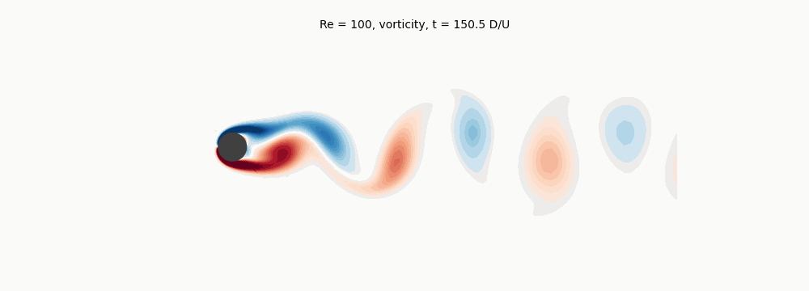
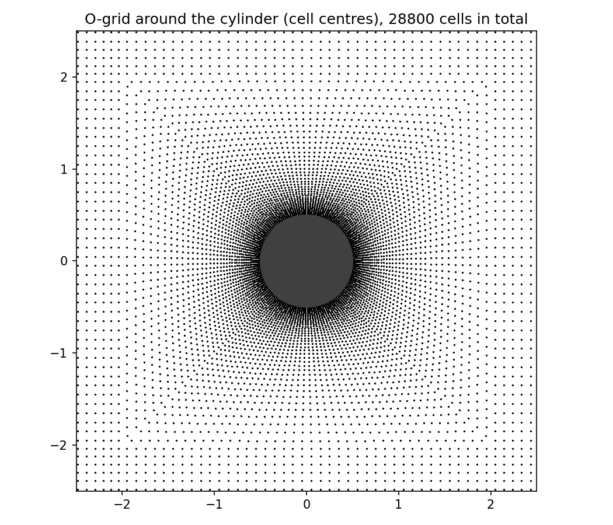
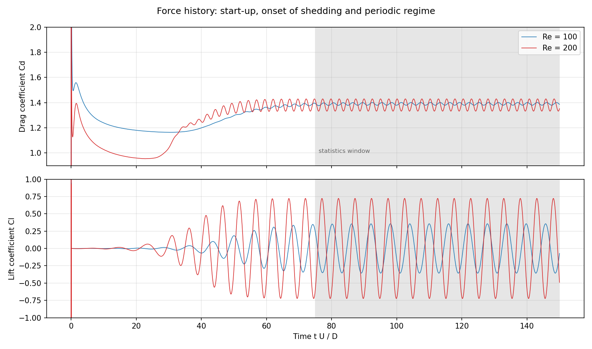
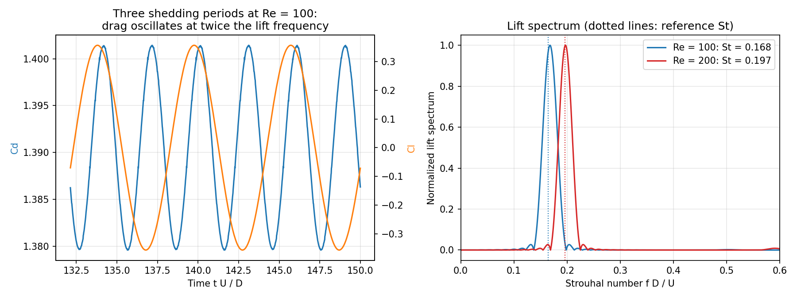
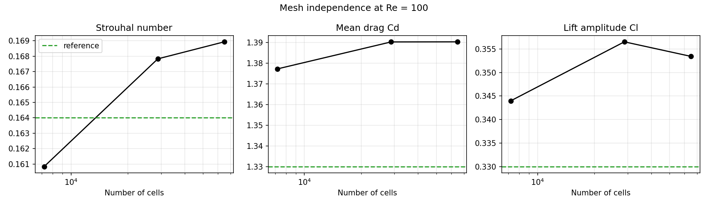
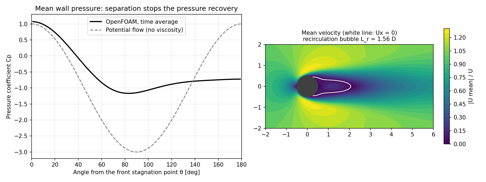
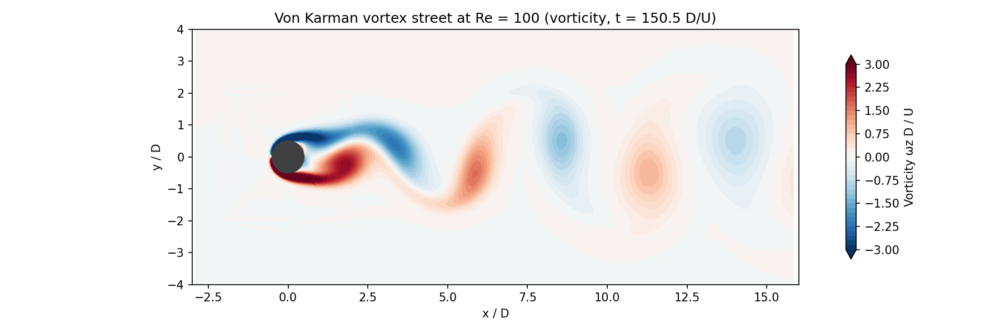

# Vortex Shedding Behind a Circular Cylinder (OpenFOAM + Python)

A fully scripted CFD study of the classic von Kármán vortex street. One Python script writes the mesh and the OpenFOAM case, runs four transient simulations in parallel, and post-processes everything: forces, Strouhal number, mesh independence, time-averaged flow and an animation. The results are validated against published experiments and simulations.



## Why this flow matters

Above Re ≈ 47, the wake behind a cylinder becomes unstable and sheds vortices alternately from the top and the bottom. Each vortex produces a side force, so the cylinder feels a periodic lift force at the shedding frequency and a drag force oscillating at twice that frequency. This is what makes power lines sing in the wind and what engineers check on chimneys, risers, cables and heat-exchanger tubes: if the shedding frequency approaches a structural natural frequency, the structure can lock in and fatigue. The dimensionless shedding frequency is the **Strouhal number**, St = f·D / U.

## Setup

| Item | Value |
|---|---|
| Solver | OpenFOAM 12, `foamRun` with the `incompressibleFluid` module (PIMPLE), laminar |
| Reynolds number | 100 and 200 (Re = U·D / ν, with D = 1 and U = 1) |
| Domain | 10 D upstream, 30 D downstream, 20 D wide (5% blockage) |
| Boundary conditions | uniform inlet velocity, zero pressure at the outlet, no-slip wall, symmetry planes on the sides |
| Mesh | structured O-grid, 12 blocks, graded towards the wall (first cell ≈ 0.01 D) |
| Numerics | 2nd order in space (`linearUpwind` for convection) and time (`backward`), adaptive time step with Courant ≤ 0.8 |
| Statistics | t = 75 to 150 D/U (11 to 14 full shedding periods) |



## Results

### Force history



The flow first develops a symmetric pair of attached vortices. A small cross-flow perturbation in the initial field grows, the wake starts to oscillate, and after t ≈ 60 the lift and drag settle into a perfectly periodic regime. Statistics are taken only from the grey window.

### Shedding frequency



On the left, the drag oscillates at **twice the lift frequency**: every vortex, top or bottom, adds a drag pulse, while the lift changes sign between them. On the right, the lift spectrum shows one sharp peak, at St = 0.168 for Re = 100 and St = 0.197 for Re = 200. St is computed in two independent ways, from zero crossings of the lift signal and from an FFT, and both agree to 4 digits.

### Validation

| Quantity | Re | This work | Reference | Difference |
|---|---|---|---|---|
| Strouhal number | 100 | 0.169 | 0.164 (Williamson 1996, experiments) | +3.0% |
| Mean drag Cd | 100 | 1.390 | 1.33 (Park, Kwon & Choi 1998) | +4.5% |
| Lift amplitude Cl | 100 | 0.353 | 0.33 (Park, Kwon & Choi 1998) | +7.1% |
| Strouhal number | 200 | 0.197 | 0.196 (2D simulations) | +0.5% |
| Mean drag Cd | 200 | 1.382 | 1.34 (2D simulations) | +3.2% |
| Lift amplitude Cl | 200 | 0.723 | 0.68 (2D simulations) | +6.3% |

The shedding frequency agrees within 3%. Drag and lift are 3 to 7% high, and the reason is the domain, not the mesh (see below). The side boundaries are 10 D away, so the cylinder blocks 5% of the channel. The flow has to accelerate around it, which increases the forces and the shedding frequency slightly. The reference studies use much wider domains. This is a deliberate trade-off to keep the run time short, and the size of the effect is consistent with what blockage studies in the literature report.

### Mesh independence (Re = 100)



| Mesh | Cells | St | Cd mean | Cl amplitude |
|---|---|---|---|---|
| Coarse | 7,200 | 0.1608 | 1.3773 | 0.3440 |
| Medium | 28,800 | 0.1678 | 1.3903 | 0.3565 |
| Fine | 64,800 | 0.1689 | 1.3904 | 0.3534 |

From the medium to the fine mesh, St changes by 0.65%, Cd by 0.00% and Cl by 0.87%. The medium mesh is converged, and it runs about 3.4 times faster than the fine one: the fine mesh has 2.25 times more cells, and its smaller cells also force a smaller time step to keep the Courant number at 0.8. The coarse mesh underpredicts St by almost 5%, which shows why a mesh study is needed at all.

### Time-averaged flow



- **Front stagnation point:** Cp = 1.07. It is above the inviscid value of 1 because viscous effects are significant at this Reynolds number.
- **Separation:** the pressure drops to a minimum near 80°, then the boundary layer separates and the pressure stops recovering. Potential flow, which has no viscosity, predicts full recovery to Cp = 1 at the rear and therefore zero drag (d'Alembert's paradox).
- **Base pressure:** Cp(180°) = −0.72. That suction on the rear face is what creates most of the pressure drag.
- **Recirculation bubble:** the mean flow shows a closed bubble behind the cylinder, with length L_r = 1.56 D measured from the rear surface.

### Vortex street



Red is counter-clockwise vorticity and blue is clockwise. The shear layers roll up alternately and are carried downstream as a staggered double row of vortices.

## How to run

Requirements: Linux or WSL with [OpenFOAM 12](https://openfoam.org/) and Python 3 with numpy, matplotlib and scipy.

```bash
source /opt/openfoam12/etc/bashrc
python3 cylinder_vortex_shedding.py
```

The four cases run in parallel. On a desktop PC, the medium mesh takes about 12 minutes and the fine mesh about 35 minutes. Finished simulations are detected and reused, so post-processing can be changed and rerun in seconds (`RERUN = True` forces new simulations). The script also supports the ESI version of OpenFOAM (`FLAVOR = "esi"`).

Each case folder is a standard OpenFOAM case and can be opened in ParaView (`paraFoam` or `foamToVTK`).

## Files

| File | Content |
|---|---|
| `cylinder_vortex_shedding.py` | Mesh, case setup, runs and post-processing |
| `results/report.txt` | Every number in this README |
| `results/*.png`, `results/*.gif` | Figures and animation |

## Limits and possible extensions

- Above Re ≈ 190 the real wake becomes three-dimensional, so a 2D model at Re = 200 is a numerical benchmark more than a prediction of the physical flow.
- A wider domain (or a blockage correction) would bring Cd and Cl closer to the unbounded references.
- Extensions: a Reynolds sweep (St vs Re against Williamson's curve), 3D LES at Re = 3900, and a cylinder mounted on springs (vortex-induced vibration, coupling the flow with a structural model).
